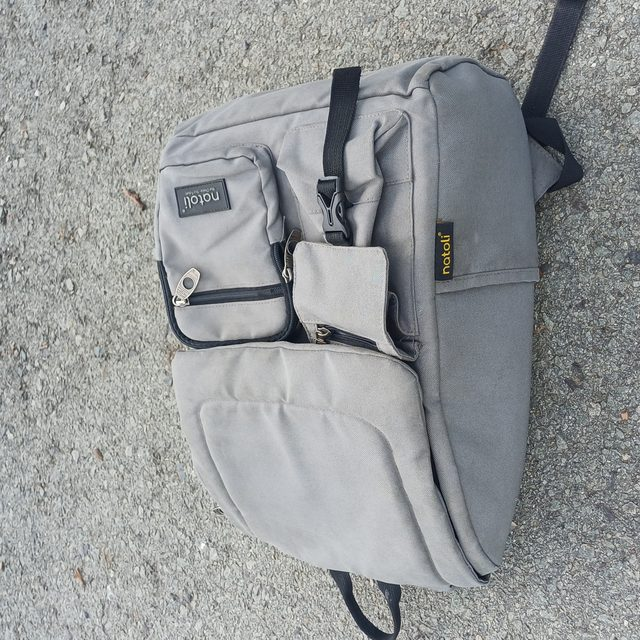
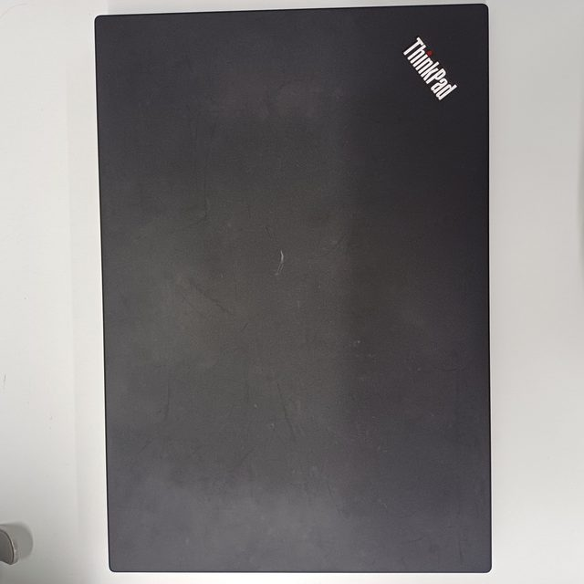
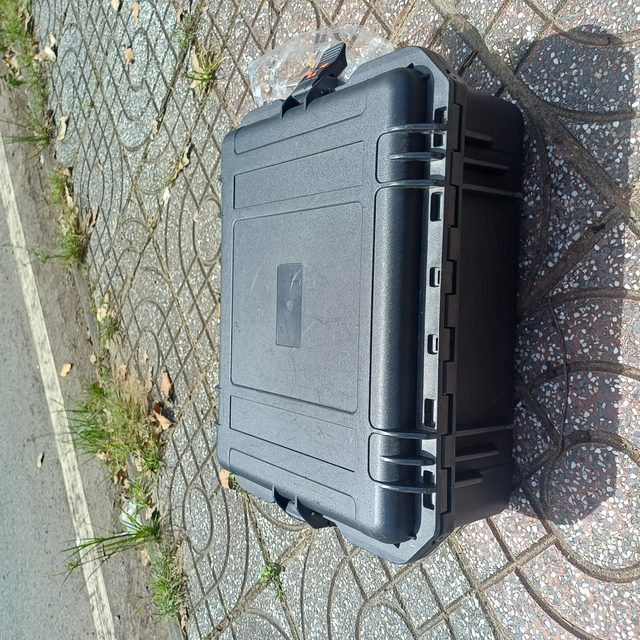
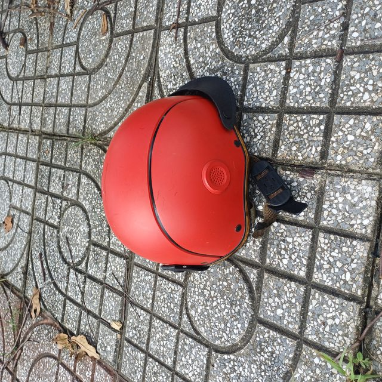

# AeroEyes

## Hệ thống tìm kiếm và định vị mục tiêu bằng UAV tự hành

AeroEyes là một hệ thống nhận thức máy tính chạy trực tiếp trên máy bay không người
lái (UAV), có nhiệm vụ tìm kiếm một đối tượng mục tiêu cụ thể trong video do camera
trên UAV ghi lại. Hệ thống nhận một số lượng hạn chế ảnh tham chiếu của mục tiêu,
sau đó xác định **đối tượng xuất hiện ở thời điểm nào và tại vị trí nào trong video**.

Giải pháp hướng tới các nhiệm vụ tìm kiếm và cứu hộ trong điều kiện khó khăn như:

- khu vực ngập lụt hoặc có địa hình bị chia cắt;
- rừng rậm, vùng núi và khu vực khó tiếp cận;
- khu vực sau bão, sạt lở hoặc thiên tai;
- tìm người, phương tiện, giấy tờ hoặc vật dụng sinh tồn bị thất lạc.

Mục tiêu của dự án là xây dựng một năng lực có thể vận hành độc lập trên UAV thực
tế, thay vì chỉ xử lý video sau chuyến bay hoặc gửi dữ liệu lên máy chủ bên ngoài.

## Bài toán

Với mỗi nhiệm vụ, hệ thống được cung cấp:

1. một video quan sát từ UAV;
2. một tập nhỏ ảnh tham chiếu của đối tượng cần tìm;
3. các thông tin vận hành cần thiết như độ phân giải, tốc độ khung hình và trạng thái
   chuyến bay.

Hệ thống phải trả về:

- các khung hình mà đối tượng xuất hiện;
- khung giới hạn (bounding box) của đối tượng trong từng khung hình;
- thời điểm bắt đầu, thời điểm kết thúc và độ tin cậy của lần phát hiện;
- vị trí phát hiện để bộ điều khiển UAV hoặc nhân viên cứu hộ có thể sử dụng.

Đây là bài toán phát hiện mục tiêu theo truy vấn hình ảnh (query-based object
detection), trong đó mô hình không nhất thiết được huấn luyện riêng cho từng loại
đối tượng. Ba ảnh tham chiếu của một mục tiêu có thể có góc nhìn, kích thước,
ánh sáng hoặc mức độ che khuất khác nhau.

## Mục tiêu kỹ thuật

- Nhận diện đúng mục tiêu từ ít ảnh tham chiếu.
- Định vị mục tiêu theo cả hai chiều không gian và thời gian.
- Hoạt động theo thời gian thực hoặc gần thời gian thực trên thiết bị biên.
- Không phụ thuộc vào Wi-Fi, điện toán đám mây hoặc máy chủ bên ngoài trong khi UAV
  đang thực hiện nhiệm vụ.
- Duy trì độ ổn định khi mục tiêu nhỏ, bị che khuất, xuất hiện gần rìa ảnh hoặc
  thay đổi nhanh do chuyển động của UAV.
- Cung cấp kết quả có thể truy vết để hỗ trợ xác minh và phân tích sau nhiệm vụ.

## Kiến trúc hệ thống đề xuất

Luồng xử lý chính:

```text
Ảnh tham chiếu mục tiêu
          |
          v
Trích xuất đặc trưng truy vấn
          |
          v
Video từ camera UAV -> Tiền xử lý -> Phát hiện/đối sánh -> Theo dõi
                                             |
                                             v
                                Lọc theo thời gian và xác nhận
                                             |
                                             v
                         Bounding box + timestamp + confidence
                                             |
                                             v
                       Giao tiếp với bộ điều khiển / giao diện cứu hộ
```

Các thành phần cần được tách biệt để có thể thay thế độc lập:

1. **Input và tiền xử lý**: đọc luồng camera, chuẩn hóa ảnh, điều chỉnh kích thước
   và đồng bộ timestamp.
2. **Mã hóa ảnh tham chiếu**: tạo biểu diễn đặc trưng từ các ảnh mẫu giới hạn.
3. **Phát hiện và đối sánh**: tìm vùng ảnh tương đồng với mục tiêu trong từng
   khung hình.
4. **Theo dõi theo thời gian**: liên kết các phát hiện giữa các khung hình, giảm
   nhiễu và xác định khoảng thời gian xuất hiện liên tục.
5. **Xác nhận kết quả**: áp dụng ngưỡng tin cậy, kiểm tra tính nhất quán không gian
   - thời gian và loại bỏ các phát hiện ngắn hoặc không ổn định.
6. **Xuất kết quả và tích hợp UAV**: ghi kết quả cục bộ, hiển thị cảnh báo và gửi
   tọa độ/điểm đánh dấu cho bộ điều khiển khi có giao tiếp nội bộ phù hợp.

PyTorch được ưu tiên trong giai đoạn phát triển và triển khai. Việc tối ưu bằng
TensorRT hoặc định dạng suy luận khác chỉ được thực hiện nếu vẫn bảo đảm tính đúng
đắn của kết quả và khả năng vận hành trên phần cứng mục tiêu.

## Giới hạn thiết bị triển khai

Phiên bản triển khai mục tiêu phải tương thích với cấu hình NVIDIA Jetson Xavier NX
sau:

| Thành phần | Giới hạn kỹ thuật |
| --- | --- |
| Thiết bị | NVIDIA Jetson Xavier NX (16 GB) |
| GPU | GPU NVIDIA Volta 384 nhân, 48 Tensor Cores |
| CPU | NVIDIA Carmel 6 nhân (6 MB L2 + 4 MB L3 cache) |
| Bộ nhớ | 16 GB LPDDR4X (128-bit) |
| Hệ điều hành | Ubuntu 20.04 (JetPack 5.x) |
| CUDA | 11.4.14 |
| cuDNN | 8.4.1 |
| TensorRT | 8.4.1 |
| PyTorch | 1.12.1 |
| Giới hạn kích thước mô hình | Không quá 50 triệu tham số, sử dụng FP16 hoặc INT8 |

Các giới hạn trên là điều kiện thiết kế, không chỉ là cấu hình tham khảo. Mọi mô
hình và pipeline trước khi đưa lên UAV phải được kiểm tra trên đúng nền tảng này,
bao gồm mức sử dụng bộ nhớ, thời gian suy luận, nhiệt độ và độ ổn định khi chạy
liên tục. Mô hình vượt quá 50 triệu tham số hoặc yêu cầu phiên bản CUDA, cuDNN,
TensorRT hay PyTorch khác phải được đánh giá tương thích riêng trước khi sử dụng.

## Môi trường ảo

Môi trường Python được cô lập bằng `venv` để tránh làm thay đổi Python hệ thống
của JetPack. Cấu hình đã được chuẩn hóa trong
[requirements-jetson.txt](c:/PROJECTS/AeroEyes/requirements-jetson.txt) và các
script trong [scripts/](c:/PROJECTS/AeroEyes/scripts/).

### Cài đặt trên Jetson

Jetson Xavier NX sử dụng Ubuntu 20.04 và Python 3.8 làm baseline tương thích với
PyTorch 1.12.1:

```bash
./scripts/setup_venv.sh
source .venv/bin/activate
./scripts/activate_runtime.sh
```

PyTorch không được lấy tùy ý từ PyPI. Sau khi tạo môi trường, cần cài wheel
PyTorch 1.12.1 tương thích với JetPack 5.x, CUDA 11.4 và kiến trúc Jetson từ
nguồn NVIDIA đã được phê duyệt. Các thư viện còn lại được cài từ
`requirements-jetson.txt`.

### Cài đặt trên Windows để phát triển

Windows chỉ dùng cho phát triển và kiểm thử logic; kết quả hiệu năng GPU phải được
đo lại trên Jetson:

```powershell
.\scripts\setup_venv.ps1
.\.venv\Scripts\Activate.ps1
.\scripts\activate_runtime.ps1
```

Script mặc định dùng Python 3.8. Có thể chỉ định trình thông dịch khác khi môi
trường phát triển không có `py -3.8`, nhưng bản triển khai trên Jetson vẫn phải
được kiểm tra với đúng phiên bản đã nêu trong mục [Giới hạn thiết bị triển
khai](#giới-hạn-thiết-bị-triển-khai).

## Giới hạn xử lý khi chạy môi trường ảo

Các biến trong [config/runtime_limits.env](c:/PROJECTS/AeroEyes/config/runtime_limits.env)
là giới hạn vận hành mặc định:

| Nhóm | Giới hạn |
| --- | --- |
| Thiết bị suy luận | GPU `cuda:0` |
| Độ chính xác | FP16 |
| Batch | 1 |
| Ảnh đầu vào suy luận | Tối đa 1280 x 720 |
| Tốc độ mục tiêu | 15 FPS |
| Độ trễ mỗi khung hình | Không quá 100 ms |
| Bộ nhớ RAM dành cho pipeline | Tối đa 4096 MB |
| Hàng đợi khung hình | Tối đa 2 khung |
| Bộ đệm video | Tối đa 2 giây |
| Ảnh tham chiếu | Tối đa 3 ảnh cho mỗi mục tiêu |
| CPU thread cho BLAS/OpenMP | Tối đa 4 thread chính |
| Kích thước mô hình | Không quá 50 triệu tham số |

Các giới hạn này nhằm ngăn pipeline suy luận chiếm tài nguyên của flight
controller, camera và các dịch vụ an toàn bay. Hệ thống phải xử lý theo kiểu
streaming, loại bỏ khung cũ khi hàng đợi đầy, không tải toàn bộ video vào RAM và
không tự động tăng batch size. Khi vượt giới hạn bộ nhớ hoặc độ trễ, pipeline phải
ghi log, giảm tải theo cấu hình được phê duyệt hoặc dừng phát hiện an toàn; không
được âm thầm chuyển sang suy luận cloud hay thiết bị ngoài UAV.

Các con số trên là ngưỡng vận hành ban đầu cần được xác nhận bằng benchmark trên
Jetson thật. Việc tăng bất kỳ giới hạn nào phải được đánh giá lại cùng lúc về
ST-IoU, FPS, nhiệt độ, bộ nhớ và độ ổn định chuyến bay.

## Đánh giá bằng ST-IoU

Độ chính xác cần phản ánh đồng thời **đúng thời điểm** và **đúng vị trí**, vì vậy
AeroEyes sử dụng chỉ số giao điểm trên hợp nhất không gian-thời gian ba chiều
(Spatio-Temporal Intersection over Union, ST-IoU).

Mỗi kết quả phát hiện được xem là một thể tích trong hệ trục:

- trục thời gian hoặc số thứ tự khung hình;
- trục tọa độ ngang của ảnh;
- trục tọa độ dọc của ảnh.

Với thể tích dự đoán `P` và thể tích thực tế `G`:

```text
ST-IoU(P, G) = volume(P ∩ G) / volume(P ∪ G)
```

Trong đó, thể tích bao gồm cả khoảng thời gian mục tiêu được phát hiện và vùng
không gian mà bounding box chiếm trong từng khung hình. Nếu hệ thống phát hiện sai
thời điểm, sai vị trí hoặc sai kích thước bounding box thì phần giao nhau sẽ giảm.
Một phát hiện chỉ có ý nghĩa khi cả thông tin thời gian và không gian đều phù hợp
với dữ liệu thực tế.

Điểm tổng hợp của một tập video là trung bình ST-IoU trên các video được đánh giá:

```text
Mean ST-IoU = (1 / N) * Σ ST-IoU(video_i)
```

Ngoài ST-IoU, khi đưa vào vận hành cần theo dõi thêm:

- độ trễ từ lúc nhận khung hình đến lúc phát hiện;
- tốc độ xử lý (FPS) và mức sử dụng CPU/GPU;
- độ ổn định trong suốt chuyến bay;
- thời gian từ lúc bắt đầu quét đến lúc xác định được mục tiêu;
- mức tiêu thụ điện và ảnh hưởng đến thời lượng bay.

## Dữ liệu trong repository

Repository hiện được tổ chức theo các nhóm dữ liệu sau:

```text
train/
├── annotations/
│   └── annotations.json
└── samples/
    └── <target>_<instance>/
        ├── drone_video.mp4
        └── object_images/
            ├── img_1.jpg
            ├── img_2.jpg
            └── img_3.jpg

public_test/
└── samples/
    └── <target>_<instance>/
        ├── drone_video.mp4
        └── object_images/

private_test/
└── samples/
    └── <target>_<instance>/
        ├── drone_video.mp4
        └── object_images/
```

`train/annotations/annotations.json` chứa bounding box theo khung hình để huấn
luyện và kiểm thử nội bộ. Các thư mục `public_test/` và `private_test/` được dùng
để kiểm tra khả năng tổng quát hóa trên những video không dùng trong quá trình
phát triển.

### Minh họa dữ liệu

Các ảnh dưới đây là bản thu nhỏ dùng cho tài liệu; dữ liệu gốc vẫn được giữ
ngoài Git vì kích thước lớn. Chúng minh họa ảnh tham chiếu từ tập train và các
target trong public/private test:

| Tập dữ liệu | Ví dụ |
| --- | --- |
| Train - Backpack |  |
| Train - Laptop |  |
| Public test - BlackBox |  |
| Private test - Helmet |  |

Một số clip ngắn đã được giảm kích thước và cắt từ video mẫu để minh họa luồng
UAV. Có thể mở trực tiếp trên GitHub:

- [Train - Backpack preview](./docs/assets/train_backpack_preview.mp4)
- [Public test - BlackBox preview](./docs/assets/public_blackbox_preview.mp4)

Các asset minh họa không thay thế dataset huấn luyện và không chứa toàn bộ
annotation/video gốc.

Tên mục tiêu hiện có trong dữ liệu gồm các vật thể như ba lô, áo khoác, máy tính
xách tay, phao cứu sinh, điện thoại, người, chai nước, mũ bảo hiểm, thẻ căn cước,
xe máy, ví, hộp và áo phao. Danh sách này là ví dụ của tập dữ liệu hiện tại; hệ
thống cần được thiết kế để có thể tiếp nhận mục tiêu mới thông qua ảnh tham chiếu.

## Yêu cầu triển khai trên UAV

- Mô hình và toàn bộ pipeline suy luận phải chạy trực tiếp trên máy bay không
  người lái hoặc thiết bị tính toán gắn trên máy bay.
- Không sử dụng Wi-Fi, suy luận trên cloud hoặc dịch vụ bên ngoài trong nhiệm vụ.
- Có thể sử dụng dữ liệu và mô hình mã nguồn mở, nhưng phải kiểm tra giấy phép
  trước khi đưa vào sản phẩm.
- Pipeline phải chịu được mất kết nối với trạm điều khiển và lưu kết quả tạm thời
  cục bộ.
- Cần có cơ chế giới hạn nhiệt độ, mức sử dụng tài nguyên và xử lý lỗi camera để
  tránh làm mất ổn định chuyến bay.
- Các bản ghi chứa dữ liệu nhiệm vụ phải được bảo vệ, giới hạn quyền truy cập và
  xóa theo chính sách lưu trữ đã phê duyệt.

Phần cứng mục tiêu là NVIDIA Jetson Xavier NX (16 GB) theo cấu hình ở mục
[Giới hạn thiết bị triển khai](#giới-hạn-thiết-bị-triển-khai). Camera, độ cao bay và
giới hạn tốc độ cần được chốt trong hồ sơ triển khai của từng loại UAV; các thông
số này không nên được mã hóa cứng trong mô hình.

## An toàn và quyền riêng tư

AeroEyes là công cụ hỗ trợ tìm kiếm, không thay thế quyết định của người điều
khiển hoặc lực lượng cứu hộ. Hệ thống phải:

- hiển thị độ tin cậy và trạng thái dữ liệu thay vì biến mọi dự đoán thành cảnh báo
  chắc chắn;
- ghi lại timestamp, phiên bản mô hình và cấu hình suy luận để phục vụ kiểm tra;
- cho phép nhân viên xác minh hình ảnh trước khi điều hướng UAV hoặc triển khai
  lực lượng;
- không lưu trữ hoặc tái sử dụng dữ liệu nhiệm vụ ngoài mục đích đã được cấp phép;
- tuân thủ quy định về an toàn bay, bảo vệ dữ liệu cá nhân và quản lý dữ liệu hình
  ảnh.

## Tiêu chí nghiệm thu

Một phiên bản có thể triển khai cần đáp ứng tối thiểu các nhóm kiểm tra sau:

1. **Độ chính xác**: đạt ngưỡng ST-IoU được quy định cho tập kiểm thử và không
   phát sinh cảnh báo sai nghiêm trọng.
2. **Độ trễ**: xử lý ổn định ở tốc độ khung hình mục tiêu trên phần cứng Jetson
   được chọn.
3. **Độ bền**: tiếp tục hoạt động khi mục tiêu nhỏ, bị che khuất, ánh sáng thay
   đổi hoặc video có rung.
4. **Tính độc lập**: hoàn thành suy luận khi không có kết nối mạng.
5. **Khả năng vận hành**: khởi động, ghi log, phục hồi lỗi và kết thúc nhiệm vụ
   an toàn mà không cần thao tác phát triển thủ công.

## Lộ trình phát triển

1. Chuẩn hóa loader cho video, ảnh tham chiếu và annotation.
2. Xây dựng baseline phát hiện/đối sánh và bộ đo ST-IoU.
3. Bổ sung theo dõi đa khung hình và cơ chế xác nhận phát hiện.
4. Đánh giá độ chính xác, độ trễ và mức sử dụng tài nguyên trên Jetson.
5. Tích hợp luồng camera, timestamp và giao tiếp nội bộ với flight controller.
6. Kiểm thử trong môi trường mô phỏng, sau đó kiểm thử có kiểm soát trên UAV.
7. Đóng gói bản triển khai, thiết lập logging, giám sát và quy trình cập nhật mô
   hình an toàn.

## Trạng thái

Repository hiện cung cấp dữ liệu mẫu, annotation huấn luyện và tài liệu định hướng
cho pipeline AeroEyes. Các thành phần mô hình, suy luận thời gian thực, tích hợp
Jetson và giao tiếp với UAV sẽ được triển khai theo lộ trình ở trên.

## Huấn luyện baseline

Script [train.py](./train.py) triển khai baseline Siamese-Modulated Single-Stage
Detector cho bài toán phát hiện theo ảnh truy vấn. Script đọc annotation theo
`video_id`, lấy frame trực tiếp từ video, chọn tối đa ba ảnh tham chiếu của cùng
mục tiêu, dùng NWD cho bbox và chia tập validation theo video (không chia ngẫu
nhiên theo frame). Mô hình không dùng classifier cố định; ảnh truy vấn quyết định
mục tiêu cần tìm.

Trên máy phát triển hoặc Jetson sau khi đã cài PyTorch tương thích:

```powershell
python train.py --data-root AeroEyes_dataset --epochs 40 --device auto --export-onnx
```

Kết quả được ghi vào `runs/aeroeyes/` gồm `best.pt`, `last.pt` và tùy chọn
`aeroeyes_detector.onnx` (ONNX opset 13). Có thể dùng
`--max-train-samples` và `--max-val-samples` để smoke test; đây chỉ là giới hạn
chạy thử, không nên dùng khi huấn luyện chính thức. Việc tích hợp CMC, ByteTrack,
hysteresis tubelet và TensorRT vẫn là bước suy luận/triển khai sau huấn luyện,
không được giả lập bằng cách đưa thông tin tương lai vào loader huấn luyện.

### Huấn luyện song song trên Kaggle/Colab

File [training/main_training.py](./training/main_training.py) dùng PyTorch DDP và `DistributedSampler`.
`--batch-size` là batch trên **mỗi GPU**, vì vậy batch toàn cục bằng
`batch-size x số GPU`. Chạy nhiều GPU bằng `torchrun`:

```bash
torchrun --standalone --nproc_per_node=2 training/main_training.py \
  --data-root /kaggle/input/aeroeyes-dataset \
  --output-dir /kaggle/working/aeroeyes-ddp \
  --epochs 40 --batch-size 2 --workers 2 --export-onnx
```

Trong Colab, thay đường dẫn dataset bằng thư mục Google Drive hoặc thư mục đã
giải nén. Với một GPU, có thể chạy cùng file mà không cần `torchrun`:

```bash
python training/main_training.py --data-root /content/AeroEyes_dataset \
  --output-dir /content/aeroeyes-ddp --epochs 40 --batch-size 2
```

Chỉ rank 0 ghi `best.pt`, `last.pt` và ONNX để tránh các process ghi đè nhau.
Có thể tiếp tục từ checkpoint bằng `--resume /path/to/last.pt`; dùng
`--max-train-samples 1 --max-val-samples 1 --epochs 1` để kiểm tra notebook
trước khi chạy đầy đủ.

### Backbone và module nguyên mẫu đa tầng

[training/main_training.py](./training/main_training.py) hiện thực hóa bản lai
nhẹ của AeroEyes dựa trên các ý tưởng quan hệ support--search trong AirDet
([arXiv:2112.01740](https://arxiv.org/abs/2112.01740)):

- backbone ba mức P3/P4/P5 kết hợp CSP bottleneck với depthwise
  ConvNeXt-Femto-like block;
- tổng hợp prototype global--local giữa các mức đặc trưng và nhiều ảnh
  support;
- fusion chéo scale giữa support và search, với prototype được đưa cả vào
  nhánh objectness lẫn hồi quy bbox (PRE-style);
- hợp nhất các mức thành một đầu ra dense để giữ tương thích với NWD loss,
  ONNX export và pipeline DDP hiện có.

`training/main_training.py` sử dụng `AirDetLiteHybridDetector` thay cho
baseline encoder đơn mức. File model chấp nhận support dạng `[B, 3, H, W]`
hoặc nhiều shot dạng `[B, K, 3, H, W]`; loader hiện tại vẫn cung cấp một shot
cho mỗi mẫu để bảo toàn schema dataset. Đây là phần áp dụng có chủ đích các
nguyên lý SCS/GLR/PRE, không phải tuyên bố tái tạo nguyên văn kiến trúc AirDet.

### Context pretraining

[training/pretraining.py](./training/pretraining.py) pretrain cùng kiến trúc
hybrid theo mục tiêu class-agnostic trên các bộ dữ liệu UAV ngữ cảnh:

- [UAVDT DET](https://www.kaggle.com/datasets/ayushkumarsinghreck/uavdt-det-uav-object-car-truck-bus);
- [VisDrone](https://www.kaggle.com/datasets/banuprasadb/visdrone-dataset);
- [Anti-UAV](https://www.kaggle.com/datasets/mm1991/anti-uav-dataset-300);
- [VisDrone videos](https://www.kaggle.com/datasets/pragadeeshwaranrv/visdrone-videos-dataset).

Script không tự tải dữ liệu. Sau khi các dataset đã được tải và giải nén,
truyền mỗi thư mục theo dạng `NAME=PATH`. Loader hỗ trợ COCO JSON, YOLO TXT,
VisDrone TXT và UAVDT GT phổ biến:

```bash
torchrun --standalone --nproc_per_node=2 training/pretraining.py \
  --dataset-root uavdt=/kaggle/input/uavdt-det \
  --dataset-root visdrone=/kaggle/input/visdrone \
  --dataset-root anti_uav=/kaggle/input/anti-uav \
  --dataset-root visdrone_video=/kaggle/input/visdrone-videos \
  --output-dir /kaggle/working/aeroeyes-pretrain \
  --epochs 20 --batch-size 8 --workers 4
```

Checkpoint `best.pt` từ pretraining có cùng state dict với model target, nên
có thể khởi tạo target training bằng:

```bash
python training/main_training.py \
  --data-root /kaggle/input/aeroeyes-target \
  --resume /kaggle/working/aeroeyes-pretrain/best.pt \
  --output-dir /kaggle/working/aeroeyes-target
```

Pretraining dùng hai view nhẹ của cùng ảnh làm support/search để học quan hệ
class-agnostic và localization tổng quát; nhãn lớp của các dataset ngữ cảnh
không được đưa vào classifier. Cần kiểm tra license và cấu trúc annotation
thực tế của từng bản tải xuống trước khi chạy quy mô lớn.
